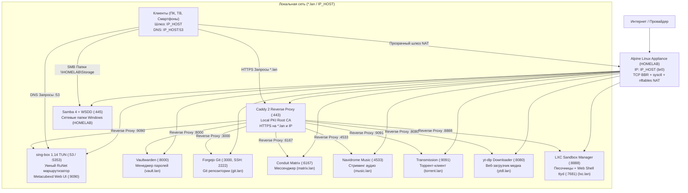

# Архитектура Zero-Docker Alpine Homelab Appliance

Данный комплекс представляет собой эталонный автономный программный комплекс микросервисов для домашнего сервера или умного шлюза, построенный исключительно на базе **Alpine Linux 3.24** с нативной супервизией **OpenRC** и встроенной песочницей изолированных Linux-контейнеров **LXC**.

Никакого Docker, Podman, systemd или тяжелых слоев виртуализации. Потребление оперативной памяти для всего комплекса из 11 сервисов составляет **менее 450 МБ RAM**.

---

## 1. Топология сети и адресация

Все сервисы хоста работают в едином оптимизированном сетевом пространстве с высокопроизводительным стеком Linux (TCP BBR + FQ, MSS Clamping, nftables NAT).

---

## 2. Спецификация сервисов

| Сервис | Порт (Хост) | Роль | Доменное имя (HTTPS) | Авторизация |
| :--- | :--- | :--- | :--- | :--- |
| **Caddy 2** | `80`, `443` | Шлюз TLS, Local PKI CA, Редиректы | `homelab.lan`, `*.lan` | — |
| **sing-box** | `53` (DNS), `9090` | TUN Transparent Proxy + DNS Engine + Metacubexd | `proxy.lan` | Basic Auth |
| **LXC Manager** | `8888` (API), `7681` (ttyd) | Менеджер песочниц Linux + Web Terminal | `lxc.lan` | Basic Auth |
| **Vaultwarden** | `8000` | Менеджер паролей Bitwarden | `vault.lan` | Внутренняя учетка |
| **Forgejo** | `3000` (HTTP), `2222` (SSH) | Git-сервер (SQLite) | `git.lan` | Внутренняя учетка |
| **Conduit** | `6167` | Федеративный мессенджер Matrix | `matrix.lan` | Внутренняя учетка |
| **Navidrome** | `4533` | Музыкальный стриминг-сервер (Subsonic) | `music.lan` | Внутренняя учетка |
| **Transmission**| `9091` | BitTorrent клиент | `torrent.lan` | Basic Auth |
| **Media Downloader**| `8080` | yt-dlp загрузчик медиафайлов | `ytdl.lan` | Basic Auth |
| **Samba / WSDD**| `445`, `139`, `3702` | Сетевые папки Windows/Mac + WSDD Discovery | `\\HOMELAB\Storage` | admin / пароль |
| **AdGuard Home**| `53` (DNS), `3001` (UI) | Опциональный DNS-блокировщик рекламы | `adguard.lan` | Basic Auth |

---

## 3. Ключевые архитектурные решения

### sing-box 1.14 Smart RuNet Routing & Binary Rule-Sets (.srs)
- **Нативные скомпилированные бинарные базы `.srs`**: Вместо примитивных списков суффиксов используются официальные базы RunetFreedom и MetaCubeX в бинарном формате sing-box 1.14:
  - `geoip-ru.srs` (103.7 KB) — полный реестр всех российских автономных систем и CIDR подсетей IPv4.
  - `geosite-tld-ru.srs` (155 B) — все национальные зоны первого уровня (`.ru`, `.su`, `.рф`, `.moscow`, `.tatar`, `.дети` и др.).
  - `geosite-category-ru.srs` (8.5 KB) — обширный реестр российских сервисов на иностранных доменах (VK, Telegram RU CDN, Yandex, Ozon, WB, банки, госуслуги).
  - `geosite-ru-blocked.srs` (533 KB) — полный реестр ресурсов, блокируемых или замедляемых в РФ (YouTube, Discord, Instagram, X/Twitter, трекеры).
  - `geosite-category-ai.srs` (2.0 KB) — официальный мета-реестр зарубежных AI-платформ (OpenAI/ChatGPT/Sora, Anthropic/Claude, Google Gemini/AI Studio, Copilot, Perplexity, Midjourney, Mistral, Grok).
- **Многоконтурный DNS-резолвер**:
  - Домены AI-сервисов (`geosite-category-ai`) резолвятся через изолированный апстрим `ai-dns` (1.1.1.1 DoT с `detour: "🤖 Нейросети"`), что исключает CDN IP mismatch и гео-блокировки.
  - Заблокированные домены (`geosite-ru-blocked`) резолвятся через `remote-dns` (1.1.1.1 DoT с `detour: "🚀 Выбор узла"`).
  - Национальные и отечественные домены (`geosite-tld-ru`, `geosite-category-ru`) резолвятся локально через `77.88.8.8` (detour `direct`), что исключает утечки и подмену.
- **Интеллектуальная фильтрация нод и выделенные группы**:
  - Скрипт `update-sub.py` автоматически отфильтровывает информационные заглушки провайдеров (`127.0.0.1:1`, `ℹ️ Срок`, `⛔️ Торренты`, `📰 Новости`).
  - Группа `🌐 Автовыбор` (`urltest`) динамически агрегирует **все 200+ реальных серверов** с пингом через `generate_204`.
  - Отдельная группа `🤖 Нейросети` (`selector`) позволяет зафиксировать чистый узел или резидентный IP специально под строгий антифрод Claude/OpenAI/Gemini.
  - Отдельная группа `Torrent` по умолчанию направляет торрент-трафик в `direct`, защищая VPN-сервер от жалоб провайдеров (DMCA).
- **Универсальный парсер входящих прокси (Universal Ingestion Engine)**:
  - Поддерживает автоматический парсинг и конвертацию в нативный sing-box 1.14:
    - Готовых JSON-подписок sing-box.
    - Стандартных Base64-подписок V2Ray (списки ссылок).
    - Одиночных share-ссылок: `vless://` (с полной поддержкой Reality, Vision, gRPC, WebSocket), `ss://` (SIP002 Base64 и AEAD-2022), `trojan://` (TLS/uTLS), `hysteria2://` / `hy2://` (Salamander обфускация).
    - Режима `direct` (для чистой работы без внешнего VPN с возможностью подключения в любой момент).
  - Интерактивный мастер в начале скрипта с тайм-аутом 30 секунд и возможностью передачи параметров через CLI-аргумент или переменную `SUB_URL`.
- **Сетевая стабильность TUN**:
  - Для интерфейса `tun0` установлен `strict_route: false`, что предотвращает коллизии с L2-мостом `br0` и гарантирует доступность хоста по SSH.
  - Уровень логирования установлен в `info` для визуализации маршрутов в веб-панели Metacubexd.

### AdGuard Home 2026 RuNet Edition
- Шифрованный апстрим через DNS-over-HTTPS (`https://dns.yandex.ru/dns-query`, `https://cloudflare-dns.com/dns-query`) исключает подмену DNS провайдерским ТСПУ.
- Включен официальный российский фильтр (Filter ID 7) против отечественных трекеров и баннерных сетей.
- Включен `cache_optimistic: true` для моментальных ответов (< 1 мс).
- Отключен IPv6 DNS (`aaaa_disabled: true`) для устранения сетевых задержек.

### Оптимизация ядра Linux (BBR TCP Congestion)
- На хосте активирован современный алгоритм управления перегрузками **Google BBR** (`net.ipv4.tcp_congestion_control = bbr`) и планировщик `fq`, обеспечивающие стабильный высокий битрейт при стриминге 4K-видео и работе с прокси.
